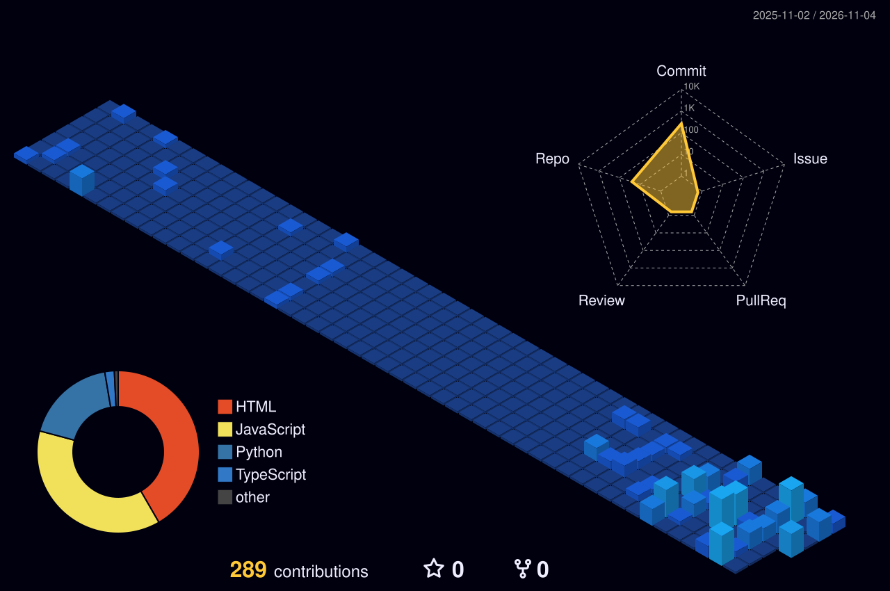

  

  

  

  

  

## projects

<!-- Auto-filled from your pinned repos. Do not remove the two marker lines. -->
<!-- PROJECTS:START -->
<table width="100%">
<tr>
<td width="50%" valign="top" align="left">
<a href="https://github.com/A7m721/ahmed-ra"><b>ahmed-ra</b></a> 
Personal website built with HTML, CSS and JavaScript 
● JavaScript · ★ 0 · 🌐 <a href="https://ahmed-ra.vercel.app">Live</a>
</td>
<td width="50%" valign="top" align="left">
<a href="https://github.com/A7m721/Enginer-ahmed"><b>Enginer-ahmed</b></a> 
My personal portfolio website, ranked #1 on Google 
● HTML · ★ 0 · 🌐 <a href="https://enginer-ahmed.vercel.app">Live</a>
</td>
</tr>
<tr>
<td width="50%" valign="top" align="left">
<a href="https://github.com/A7m721/darstore"><b>darstore</b></a> 
Online store website for ... 
● JavaScript · ★ 0 · 🌐 <a href="https://darstore-nu.vercel.app">Live</a>
</td>
<td width="50%" valign="top" align="left">
<a href="https://github.com/A7m721/alfarisbaber"><b>alfarisbaber</b></a> 
Barber shop website with booking page 
● HTML · ★ 0 · 🌐 <a href="https://alfarisbaber.vercel.app">Live</a>
</td>
</tr>
</table>
<!-- PROJECTS:END -->

<a href="https://github.com/A7m721?tab=repositories"><b>→ See all repositories</b></a>

  

## my contribution city

*Every commit raises another building. Rebuilt automatically every day.*

  

  

  

**Ship clean. Rank high. Keep building.**

